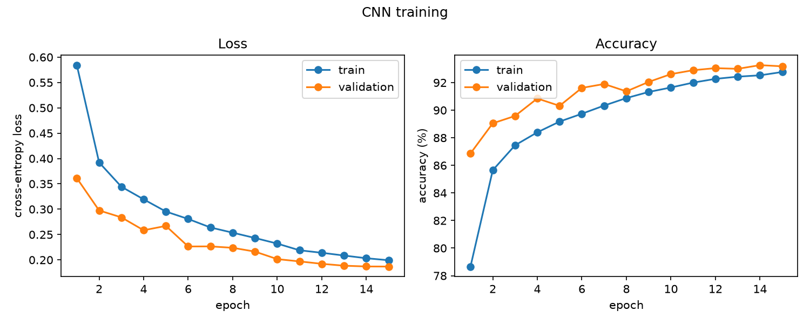
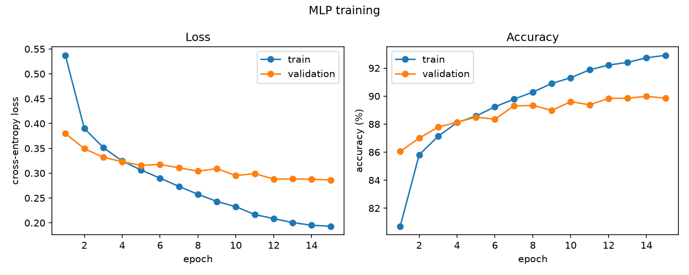
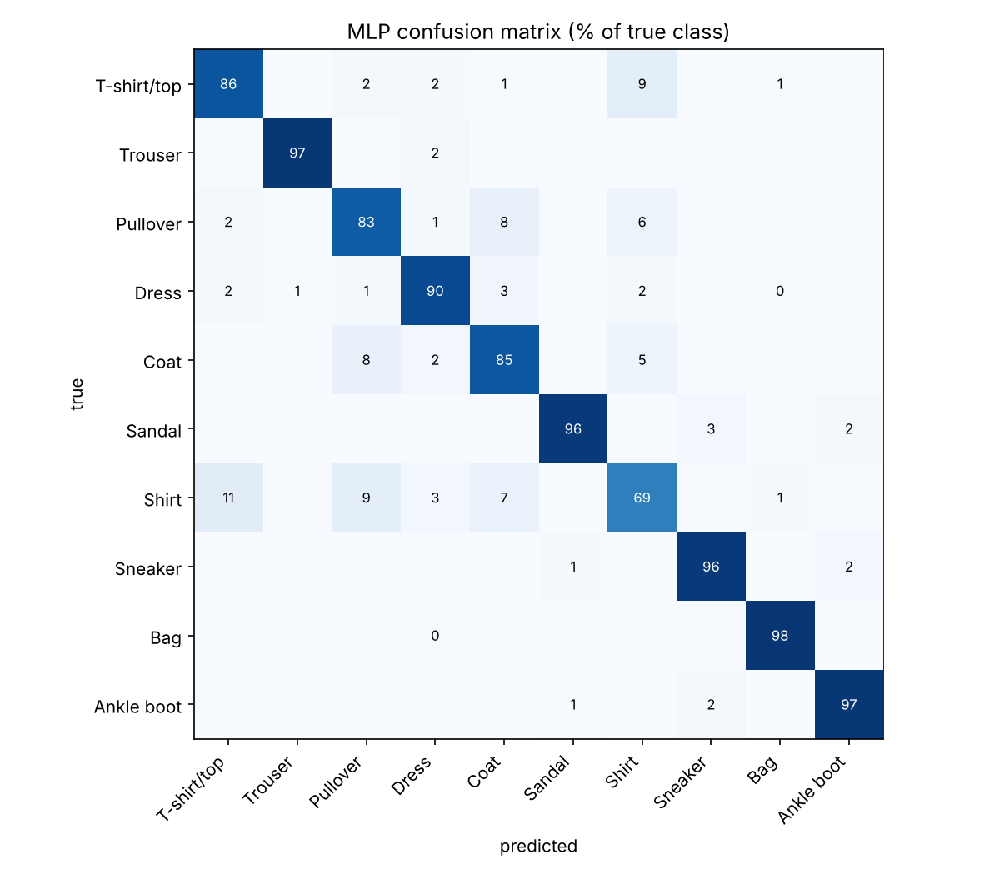

# Fashion-MNIST Classifier: MLP vs. CNN in PyTorch

This project classifies 28×28 grayscale images of clothing into 10 categories (shirts, sneakers, bags and so on). It compares a fully connected network with a small convolutional network to show how much convolution helps on image data. The training pipeline uses a proper train/validation/test split, checkpointing, learning-rate scheduling, and diagnostic plots.


## Results

Test accuracy is measured once, on the 10,000 official test images, using the checkpoint with the best validation accuracy.

| Model | Parameters | Best epoch | Validation acc. | Test acc. |
|---|---:|---:|---:|---:|
| MLP | 235,146 | 14 | 89.98% | 89.63% |
| CNN (with augmentation) | 468,010 | 14 | 93.27% | **93.02%** |

The CNN gets 698 test images wrong, compared with 1,037 for the MLP: **33% fewer mistakes**.

| CNN training | MLP training |
|---|---|
|  |  |

**Per-category test accuracy**

| Category | MLP | CNN | Change |
|---|---:|---:|---:|
| Shirt | 69.3% | 77.9% | +8.6 |
| T-shirt/top | 85.6% | 88.2% | +2.6 |
| Pullover | 83.0% | 90.6% | +7.6 |
| Coat | 84.9% | 90.7% | +5.8 |
| Dress | 90.1% | 92.7% | +2.6 |
| Ankle boot | 97.0% | 96.5% | −0.5 |
| Sneaker | 96.1% | 97.4% | +1.3 |
| Sandal | 95.8% | 98.3% | +2.5 |
| Trouser | 97.0% | 98.8% | +1.8 |
| Bag | 97.5% | 99.1% | +1.6 |

### Observations

- **The MLP overfits; the CNN doesn't.** The MLP's validation accuracy levels off near 90% from about epoch 7 while its training accuracy keeps climbing to 92.9%. The CNN's validation accuracy keeps improving through epoch 14.
- **Augmentation makes training harder than validation.** The CNN's training accuracy stays *below* its validation accuracy, because training images are randomly flipped and shifted while validation images are not.
- **Tops are the hard part.** Shirts are the worst category for both models. The CNN's biggest confusions are T-shirt → shirt (91), shirt → T-shirt (83) and shirt → coat (75). At 28×28 pixels these garments mostly differ in small details like collars and buttons, which is also where the CNN gains the most over the MLP (+8.6 points on shirts, +7.6 on pullovers).
- **Footwear and bags are nearly solved.** Both models score at least 95.8% on them, and footwear is only confused with other footwear.

<details>
<summary>MLP confusion matrix</summary>



</details>

## Project structure

```
fashion_classifier/
  data.py      # dataset download, train/val/test split, normalization, augmentation
  models.py    # MLP baseline and SmallCNN (2 conv blocks + batch norm + dropout)
  engine.py    # training loop, evaluation loop, top-k prediction
  plots.py     # training curves, confusion matrix, misclassified examples
  utils.py     # seeding, device selection (CUDA / Apple MPS / CPU), checkpoints
train.py       # train a model, keep the best checkpoint by validation accuracy
evaluate.py    # per-class accuracy, confusion matrix, error analysis on the test set
predict.py     # top-k predictions for a test image or your own photo
compare.py     # summarize all runs as a Markdown table
export_web.py  # export results and the model for the in-browser demo page
tests/         # fast unit tests on random tensors (no download needed)
```

## Getting started

Requires Python 3.9+.

```bash
python -m venv .venv
source .venv/bin/activate        # Windows: .venv\Scripts\activate
pip install -r requirements.txt
```

The dataset (~30 MB) downloads automatically into `data/` the first time you train.

```bash
# Train both models (the CNN is slower on a laptop CPU; use a GPU or Apple silicon if you have one)
python train.py --model mlp --epochs 15
python train.py --model cnn --epochs 15 --augment

# Detailed test-set analysis: per-class accuracy, confusion matrix, misclassified images
python evaluate.py runs/cnn/best.pt

# Predict a single image
python predict.py runs/cnn/best.pt --index 42
python predict.py runs/cnn/best.pt --image my_shoe.jpg --invert

# Results table for this README
python compare.py

# Export results + model weights for the web demo (writes web/)
python export_web.py

# Unit tests
pytest
```

Each run writes `best.pt`, `metrics.json`, `history.json` and `curves.png` to `runs/<model>/`. Run `python train.py --help` to see all options (optimizer, learning rate, weight decay, batch size, seed, device).

## Design decisions

- **Validation split.** 10% of the official training set is held out with a fixed seed. The best epoch is chosen on validation accuracy, and the test set is scored only once at the end, so the reported test accuracy isn't tuned to the test data.
- **Correct normalization.** The pipeline uses the Fashion-MNIST mean and std (0.2860 / 0.3530) rather than the MNIST-digits values that are commonly copied into tutorials.
- **CNN architecture.** Two blocks of `conv → BN → ReLU → conv → BN → ReLU → max-pool` shrink each image from 28×28 to 7×7 with 64 channels. A dropout-regularized classifier head follows.
- **Optimization.** AdamW with weight decay and a cosine learning-rate schedule. SGD with Nesterov momentum is available through `--optimizer sgd`.
- **Correct averages.** Loss is weighted by batch size, so a smaller final batch doesn't skew the epoch average.

## Background

This started as a short intro-to-PyTorch exercise in a university AI course: a three-layer fully connected network trained for a few epochs. I rebuilt it as a standalone project. The rebuild adds a convolutional model and a comparison against the original approach, a held-out validation set with checkpointing, data augmentation, GPU/Apple-silicon support, error analysis, a command-line interface, tests, and an in-browser demo that runs the trained CNN in plain JavaScript.

## Possible next steps

- Try a deeper network (e.g. a small ResNet) or mixed-precision training
- Average results over several random seeds and report the spread
- Try test-time augmentation or an ensemble of the MLP and CNN

## Dataset

[Fashion-MNIST](https://github.com/zalandoresearch/fashion-mnist) by Zalando Research (MIT License): 60,000 training and 10,000 test images across 10 classes.
